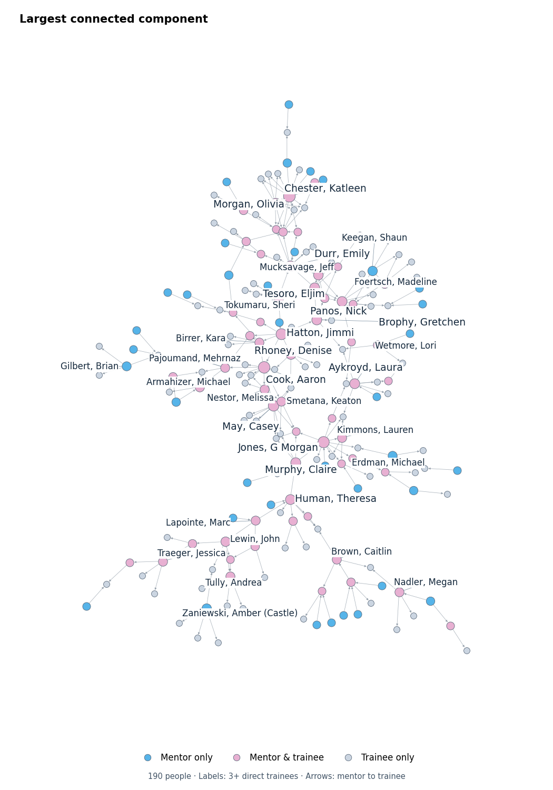
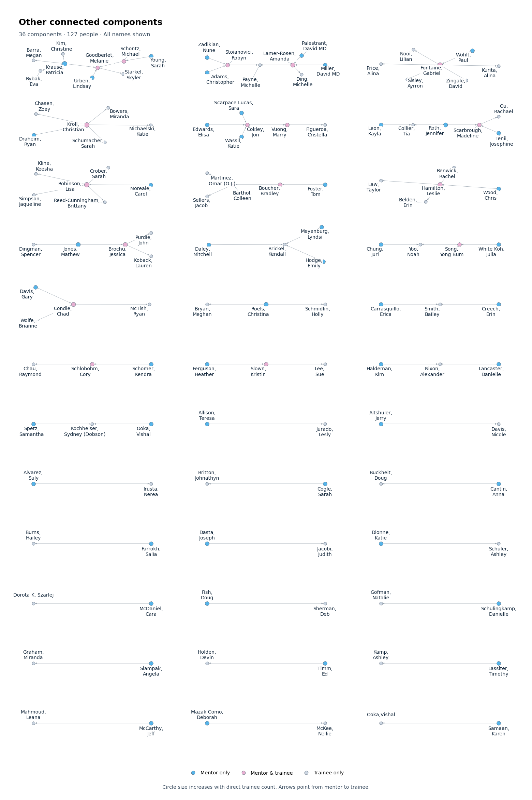

# Academic Mentorship Network

**Created by Eugene Shin**

[HTML visualization](index.html) · [R script that generates the HTML](build_network.R) · [Paper figure script](render_figure.py)

Interactive visualization of recorded preceptor and trainee relationships, with role colors, gently scaled node sizes, search, filters, and navigation controls.

## Figure previews

### Largest connected component
190 people; labels for 34 people with at least three direct trainees.



### Other connected components
36 components; all 127 names shown.



These are screen previews. Use the figure export script for the full resolution main figure.

## Open the interactive network online

After GitHub Pages is enabled, open:
https://eugene-shin-ds.github.io/mentorship-network/

Repository owner setup: **Settings → Pages → Deploy from a branch → main → / (root) → Save**. Until deployment completes, download `index.html` and open it locally.

## Why a network?

A person can have multiple preceptors and can later mentor others. A directed network preserves these connections across otherwise separate mentorship groups without assigning a single parent or an inferred generation. The current retained dataset has no directed cycles.

## Features

* Separate preceptor and trainee filters. Selecting both returns direct relationships matching both selections.
* Name search across the full network.
* Zoom, pan, fit to screen, rearrange, and freeze controls.
* Role colors: blue for mentor only, pink for mentor and trainee, gray for trainee only.
* Circle radius increases gently with the number of distinct direct trainees and is capped.
* Larger names for people with at least five direct trainees.
* Hover details show direct preceptors, direct trainees, and additional downstream connections.

Role colors, sizes, and hover counts always describe the full retained dataset, even when a filter is active. Counts do not measure mentorship quality or impact.

## Repository files

| File | Purpose |
| --- | --- |
| [index.html](index.html) | Standalone interactive network with embedded data and dependencies |
| [build_network.R](build_network.R) | Complete R script to read Excel and generate the HTML, including interface styling and interactions |
| [render_figure.py](render_figure.py) | Export the largest component as a portrait paper figure |
| [requirements.txt](requirements.txt) | Python plotting dependencies |
| [.gitignore](.gitignore) | Exclude source workbooks, local environments, and generated figures |

## View

Download `index.html` and open it in a browser. The HTML contains the visualization dependencies and relationship data. It contains real names and mentorship relationships; choose repository visibility accordingly. GitHub source view does not run HTML. GitHub Pages hosting is a separate publishing step.

## Rebuild the HTML in R

Place `Family tree Flourish data.xlsx` in the project root and run the complete `build_network.R` script from that directory in RStudio. The script reads the `Family tree links` sheet and writes `index.html`. It installs missing R packages and needs Pandoc, normally included with RStudio. The original Excel workbook is intentionally not included because other sheets contain contact details.

### Run in RStudio

1. Download the repository using **Code → Download ZIP**, then extract it.
2. Put the source workbook in the extracted project folder.
3. Open `build_network.R` in RStudio and set the working directory to that folder.
4. Run the full script:

```r
source("build_network.R", encoding = "UTF-8")
```

The script requires R 4.0 or later and the packages `readxl`, `dplyr`, `igraph`, `visNetwork`, `htmlwidgets`, `htmltools`, and `rmarkdown`. Missing packages are installed automatically. Successful execution creates `index.html`, prints the retained counts, and opens the output in the browser.

### Input format

The `Family tree links` sheet must contain these column names:

| Preceptor | Trainee |
| --- | --- |
| Example Mentor A | Example Trainee B |
| Example Mentor C | Example Trainee B |

These rows are illustrative, not study data. Names act as identifiers. Reconcile spelling variants and distinct people with identical names before analysis.

### Editable settings

At the top of `build_network.R`:

```r
input_file <- "Family tree Flourish data.xlsx"
sheet_name <- "Family tree links"
output_file <- file.path(getwd(), "index.html")
excluded_preceptors <- c("Smith, Bailey")
large_label_min <- 5L
```

The exclusion is inherited from the original analysis, not a general rule. Set `excluded_preceptors <- character(0)` only if the analysis should retain all preceptors.

Whitespace is cleaned, incomplete pairs are excluded, duplicate pairs are removed, and self relationships stop execution for review. Blank preceptors are never filled down. Directed cycles are detected and reported rather than removed automatically.

### Reproducibility status

The supplied HTML is the existing reviewed artifact. The R script was inspected but has not been executed in this environment, so byte-for-byte regeneration is not claimed.

## Export the portrait paper figure

```sh
python -m pip install -r requirements.txt
python render_figure.py
```

The Python script reads the actual node and edge data embedded in `index.html`, computes a network layout, and writes PNG at 600 dpi, SVG, and PDF to `figures/`. The largest component has 190 nodes and 240 directed edges. The figure is 7 by 10 inches, with labels for 34 people who have at least three direct trainees. Labels for five or more direct trainees are larger. Vertical position does not indicate generation or chronology.

The portable Python script passed syntax and embedded-data checks. Full execution of this packaged version was not completed here because plotting dependencies are not installed in the current runtime. The earlier figure workflow was executed and visually reviewed.

## Data scope and audit

The HTML contains 317 named nodes and 331 unique directed relationships. These were compared with the original Excel links sheet. Its 335 complete rows reduce to 332 unique relationships after removing three duplicate rows. The existing exclusion of `Smith, Bailey` as preceptor removes the relationship to `Creech, Erin`, leaving the 331 HTML relationships. No HTML-only relationships were found.

Rows without a preceptor do not establish a relationship. Twelve names without any other recorded relationship are not in the graph. The graph therefore is not a complete list of survey respondents.

Unresolved name variants are retained separately: `Gilbert, Brian` / `Gilbert,Brian`, and `Ooka, Vishal` / `Ooka,Vishal`. Confirm identity before merging. The retained graph has no self-links or directed cycles. Roles and trainee counts describe only the retained dataset.

## Methods

Interactive visualization: R with visNetwork and htmlwidgets; igraph for network calculations. Static paper figure: Python with NetworkX, Matplotlib, and adjustText. The graph layout is computed from relationships, not inferred from an image.

No open source license is assigned yet. Bundled third-party HTML dependencies retain their respective licenses.
